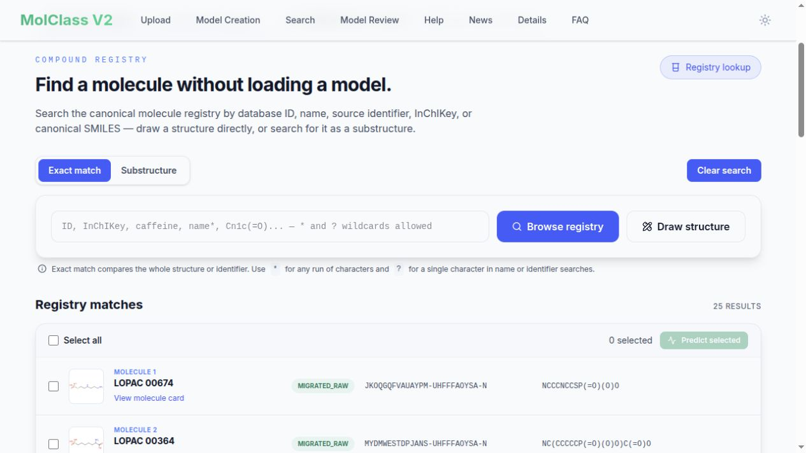
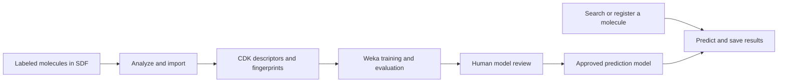

# MolClass

**Predict small-molecule bioactivity from chemical structure.** MolClass turns
labeled screening datasets into machine-learning classifiers and makes their
predictions accessible through a web interface, REST APIs, and MCP tools.
Use it to explore compounds, prioritize follow-up experiments, or build models
from your own structure–activity data.

> **Try the online server: [molclass.chemgrid.org](https://molclass.chemgrid.org)**
> No local installation is needed to browse molecules and explore published models.
>
> [Search compounds](https://molclass.chemgrid.org/search) ·
> [Prediction models](https://molclass.chemgrid.org/search?tab=models) ·
> [Dataset review](https://molclass.chemgrid.org/dataset-review) ·
> [Help](https://molclass.chemgrid.org/help)

[](https://molclass.chemgrid.org/search)

*The live MolClass compound registry, captured on 3 November 2026.*

## What is it useful for?

- **Prioritizing screening hits.** Compare predicted activity across published
  models to help select compounds for experimental follow-up and library design.
- **Exploring activity and assay liabilities.** Investigate endpoints such as
  mutagenicity, permeability, antifungal activity, autofluorescence, and compound
  aggregation using the available datasets and approved models.
- **Finding and comparing molecules.** Search by database ID, source identifier,
  name, InChIKey, or SMILES; draw a structure; or find compounds containing a
  substructure. Molecule cards connect structures, source records, properties,
  and saved predictions.
- **Building classifiers from your own experiments.** Import labeled SDF files,
  choose a target property, compare algorithms and feature profiles, and review
  evaluation evidence before publishing a model on your own deployment.
- **Automating chemical workflows.** Use the REST APIs or bundled MCP server to
  retrieve compounds, inspect models, and predict from existing molecules or new
  SMILES structures.

Predictions are model-specific estimates for the dataset's class labels. Assess
holdout performance, class support, and applicability-domain information alongside
the prediction; experimental validation is still needed. A high class probability
does not establish biological activity or safety.

## Try a prediction online

1. Open [Search](https://molclass.chemgrid.org/search). Enter a name, identifier,
   InChIKey, or SMILES, use **Draw structure**, or leave the query empty and choose
   **Browse registry**. Switch between **Exact match** and **Substructure** as needed.
2. Select one or more matching molecules and choose **Predict selected** to open
   the model tab with those molecules selected. Molecule cards also expose saved
   predictions and links back to the prediction workflow.
3. Inspect the published models and their available holdout accuracy, AUC, and F1
   metrics. Select models for which the molecule has no saved result and run the
   predictions. Results appear as each request completes and are retained for
   later visits.
4. Read the predicted class and class-probability distribution together with the
   scaffold-based applicability information, where available. Missing metrics or
   applicability values mean unavailable evidence, not a score of zero.

The home page's **MolClass molecule of the month** opens search with a structure
already loaded. When a linked structure has no exact match, **Register this
structure and predict** queues registration and feature calculation, displays
progress, and opens model selection on completion. Public prediction and
registration requests are subject to the server's quota policy.

## How it works



1. **Analyze and import.** The upload workflow inspects an SDF file, proposes an
   identifier property, and lets the operator confirm the identifier and properties
   to import. A durable worker records molecule identities, dataset membership,
   selected values, import progress, and failures. Partial imports require explicit
   acknowledgement before model creation.
2. **Generate chemical features.** The [Chemistry Development Kit (CDK)](https://cdk.github.io/)
   computes molecular descriptors and structural fingerprints. Feature profiles
   combine descriptor and fingerprint components; values are stored for reuse.
   Supported fingerprint families include MACCS, PubChem, Extended, Substructure,
   Klekota–Roth, Graph-only, EState, and ECFP4.
3. **Define and train a model.** Choose an eligible categorical target, its positive
   class, a feature profile, an algorithm, and a feature-selection policy. The
   creation API requires at least 30 labeled records and at least five records per
   class. [Weka](https://www.cs.waikato.ac.nz/ml/weka/) builds classifiers and records
   training, validation, holdout, and applicable cross-validation evidence, together
   with excluded records and checksummed model artifacts.
4. **Review and publish.** Successful training stops at `AWAITING_APPROVAL`.
   An explicit, audited human decision is required to publish the build. Training
   alone never makes a model available for prediction.
5. **Predict with the published build.** The predictor loads approved artifacts,
   checks that the molecule's feature vector matches the model contract, and saves
   the class distribution, predicted class, confidence, and available applicability
   evidence. The web interface reuses saved results for the same molecule/build.

The current model-creation implementation supports **Random Forest, J48, Naive
Bayes, SMO, k-NN, LibSVM, Logistic Model Tree, LogitBoost, Ensemble, Bagged J48,
and AdaBoost.M1**. Feature selection can use **CFS**, **ReliefF**, or **None**.
Available profiles and deployed models are listed by the server; retained legacy
model names and algorithm labels may differ from the options for new builds.

The current web interface is branded **MolClass V2**; the maintained database and
prediction contracts use **v3**. The updated GitHub wiki documents the current
workflow; historical PHP/Perl and v1 REST instructions remain in its revision
history. Current predictions return class probabilities and confidence rather
than the legacy log-odds score.

## Datasets on the online server

The [live dataset catalog](https://molclass.chemgrid.org/api/v1/datasets?limit=250)
contained **21 datasets and 63,866 imported records** on **3 November 2026**.
Counts below are dataset records, not unique molecules across the whole server.
Names follow the catalog, including historical spellings.

| Dataset ID | Dataset | Imported records |
| ---: | --- | ---: |
| 1 | Compound induced Neuronal Stem Cell Differentiation | 1,267 |
| 2 | Caco2 Penetration | 100 |
| 3 | Flucanozole Synergizer | 1,043 |
| 4 | Compound accumulation in C. elegans | 476 |
| 5 | Toxicity Benchmark | 5,351 |
| 6 | Ames Categorization | 4,261 |
| 7 | Blood Brain Barrier | 412 |
| 8 | P.falciparum Sensitivity | 1,252 |
| 9 | HSP90 PPI Inhibition | 1,614 |
| 10 | Chembank Cell Cycle Inhibitor Screen | 435 |
| 11 | BetaCell Transdifferentiation | 907 |
| 12 | Xenopus Actin Polymerization | 1,359 |
| 13 | Auto-fluorescence Prediction | 4,910 |
| 14 | Thrombin Molecule Binding | 4,876 |
| 15 | Metabolite Likeness | 982 |
| 16 | Compound aggregation | 732 |
| 17 | Liver Toxcicity | 921 |
| 18 | Antifungal Pump Inhibitors | 10,427 |
| 19 | Mitochondrial Fusion | 19,869 |
| 23 | Yeast Bioactive Library Cross-Kingdom | 1,570 |
| 31 | Microsome Clearance (AZ Hackathon) | 1,102 |

All 21 catalog entries were marked `MIGRATED` and model-eligible at the time of
this check. Dataset 23 contains 17 cross-kingdom assay targets; dataset 31 contains
categorical microsomal-clearance annotations. Dataset availability and model
publication are separate: a dataset or model definition does not guarantee an
approved predictor for every target. The
[published-model API](https://molclass.chemgrid.org/api/v3/models?limit=100)
returned **21 published models** at the same check.

Use [Dataset review](https://molclass.chemgrid.org/dataset-review) for import
outcomes and current metadata, and the
[model tab](https://molclass.chemgrid.org/search?tab=models) for models currently
available for prediction. The wiki's
[current dataset catalog](https://github.com/jwildenhain/molclass/wiki/Current-Datasets)
describes all 21 datasets, their target labels, class counts, and available
literature references. Benchmark datasets
mentioned in project news are not necessarily hosted datasets.

## Installation

For using the published models, start with the **[online server](https://molclass.chemgrid.org)**.
To run your own instance, use Docker Engine with the Docker Compose plugin, Git,
and internet access for the initial dependency downloads. See
[INSTALL.md](INSTALL.md) for the full setup guide.

```bash
git clone https://github.com/jwildenhain/molclass.git
cd molclass
cp .env.example .env
```

Edit `.env` before starting:

- Replace `MOLCLASS_DB_ROOT_PASSWORD` and `MOLCLASS_DB_PASSWORD` with separate,
  long random secrets. Keep `.env` out of version control.
- Set `MOLCLASS_CODE_REVISION` to the immutable source revision used for the build.
- Size the database and workers for your host. The example uses an **8 GiB InnoDB
  buffer pool**, a **16 GiB model-worker limit**, and a **6 GiB predictor limit**,
  plus the other services. These are large-host defaults; smaller deployments
  need adjusted settings, and training must fit the available memory.

```bash
docker compose build
docker compose up -d
docker compose ps
curl --fail http://127.0.0.1:8000/api/v1/health/readiness
```

Open **[localhost:3000](http://127.0.0.1:3000)**. Compose starts seven services and
initializes the schema from `sql/v3/` when the database volume is first created.
It does **not** download the online server's datasets or trained models. Upload
your own SDF data, create model definitions, and review the resulting builds.

**Model approval needs an administrative setup.** The stock Compose API image
does not include the host-side approval bridge, so its web approval controls
remain disabled. Follow the [model approval guide](docs/V3_MODEL_APPROVAL.md)
and [review deployment notes](docs/V3_MODEL_REVIEW.md) to publish reviewed builds
through the supported administrative path.

Services bind their published ports to loopback by default. A public deployment
needs a TLS reverse proxy and the access/configuration controls described in the
[production runbook](docs/V3_PRODUCTION_RUNBOOK.md). Data intake and configuration
are controlled separately by `MOLCLASS_DATA_INTAKE_ENABLED` and
`MOLCLASS_CONFIGURATION_ENABLED`; see the actual service settings in
[docker-compose.yml](docker-compose.yml). Store local dumps and snapshots in the
ignored `backups/` directory.

## Architecture and integrations

| Service | Role |
| --- | --- |
| `frontend` | Next.js / React web interface |
| `api` | FastAPI: uploads, datasets, model definitions, review, and job status |
| `sdf-worker` | Java / CDK: SDF analysis and import |
| `model-worker` | Java / CDK / Weka: feature generation, model training, and evaluation |
| `molecule-worker` | New-molecule registration, feature calculation, and ad-hoc prediction jobs |
| `predictor` | Spring Boot: molecule search and published-model predictions |
| `db` | MariaDB: registry, dataset membership, jobs, model evidence, and predictions |

Long-running imports, training, and molecule registration use persisted jobs with
leases and progress reporting. The current source uses CDK 2.12 and Weka 3.8.7.

REST clients use **`/api/v1`** for dataset/import/model-management workflows and
**`/api/v3`** for the molecule registry and approved-model predictions. Start with
the [prediction API](docs/V3_PREDICTION_API.md) and
[SMILES registration guide](docs/V3_ADHOC_PREDICTION.md).

The bundled [MCP server](mcp-server/README.md) exposes molecule search, model
listing, saved results, and prediction to compatible assistants. An authenticated
integration can register a SMILES structure and request all missing published-model
predictions; anonymous requests follow the documented single-model/quota policy.

## Documentation

- [Repository documentation](docs/) — technical and operational guides.
- [Installation](INSTALL.md) — Docker setup and local development entry points.
- [Search and prediction workflow](docs/V3_SEARCH_UI.md) — selection, saved results,
  registration progress, and linked structures.
- [Model creation](docs/V3_MODEL_CREATION.md), [feature generation](docs/V3_FEATURE_GENERATION.md),
  and [model review](docs/V3_MODEL_REVIEW.md) — training and publication contracts.
- [GitHub wiki](https://github.com/jwildenhain/molclass/wiki) — current user guides,
  dataset descriptions, model training, APIs, installation, and FAQs.
- [Project news](https://molclass.chemgrid.org/news) — development and benchmark reports.

## Citation and contact

If you use MolClass in your work, please cite:

> Wildenhain J, Fitzgerald N, Tyers M. *Bioinformatics.* 2012 Aug 15;28(16):2200–2201.

Contact: Jan Wildenhain — [LinkedIn](https://www.linkedin.com/in/jan-wildenhain-39908610/).
